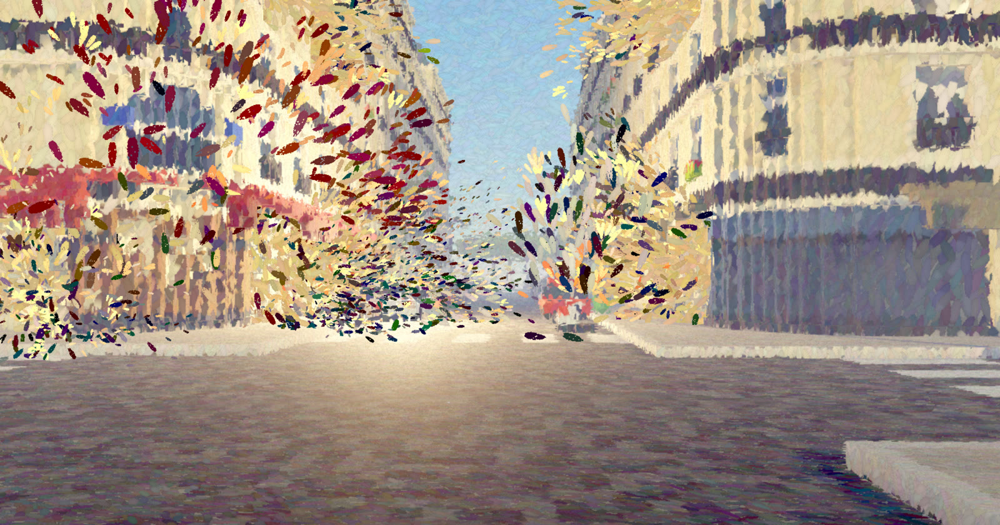
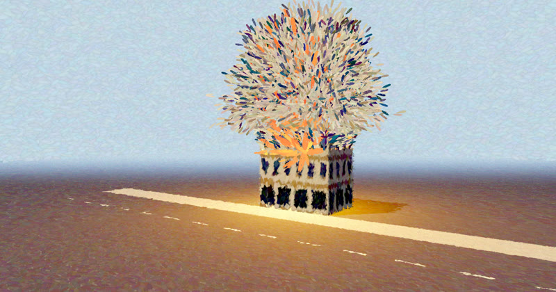
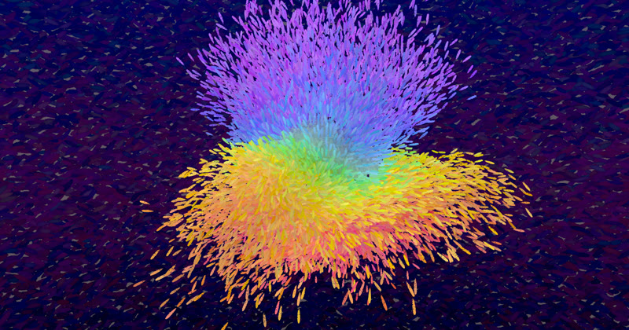

# three-painterly

Two small three.js modules, extracted from a voxel street-corner piece. Plain ES modules, no build step. Both need three.js r160 or later (WebGL 2).



| [split-time](examples/split-time/) | [paint-pulse](examples/paint-pulse/) |
|---|---|
|  |  |

*Top: [examples/voxel-paris](examples/voxel-paris/). All three examples use both modules.*

## PainterlyPass

A post-processing pass that repaints any three.js scene in impressionist brush strokes. It replaces `RenderPass`: it renders the scene itself, rebuilds world positions from depth, and lays strokes on each surface's own plane, so strokes stay on the building, tree or ground when the camera moves. It does its own tone mapping and colour-space output, so do not add an `OutputPass` after it.

```js
composer.addPass(new PainterlyPass(scene, camera, { strokeSize: 7 }));
```

Prior art: Barbara Meier, *Painterly Rendering for Animation* (SIGGRAPH 1996), placed strokes on 3D surfaces; Sekuta82/oil-on-threejs-template does this per mesh in three.js. PainterlyPass does it as a post-process from the depth buffer, so it works on any scene without touching its meshes.

→ [packages/painterly-pass](packages/painterly-pass/README.md) · example: `packages/painterly-pass/examples/basic.html`

## BakedDebris

Explosion debris you can scrub and rewind. Collisions are baked once in the browser against your own `solid(x, y, z)` query and the ground; each piece's path is stored as a few ballistic segments in a float texture, and the GPU evaluates any moment directly. `setTime(t)` can jump anywhere, backwards included, and the result is always the same. Extras: bullet-time (`timeWarp`), secondary blasts, and `createStrokes({ painter })` to draw flying pieces as brush strokes on top of a PainterlyPass.

```js
const boom = new BakedDebris({ pieces, bursts, solid, ground: 0 });
scene.add(boom.mesh);
boom.setTime(seconds);
```

→ [packages/baked-debris](packages/baked-debris/README.md) · example: `packages/baked-debris/examples/explode.html`

## Run the examples

Serve the repository root over HTTP and open an example:

```sh
python3 -m http.server     # or: npx serve .
# http://localhost:8000/packages/painterly-pass/examples/basic.html
# http://localhost:8000/packages/baked-debris/examples/explode.html
# http://localhost:8000/examples/voxel-paris/
# http://localhost:8000/examples/split-time/
# http://localhost:8000/examples/paint-pulse/
```

`examples/voxel-paris` is a larger demo that uses both modules: a Paris street corner of about 5 million voxels, where 22 bursts along the street blow out the ground floor and chosen upper floors. Drag the time slider to scrub or rewind, change the time of day, and watch flying pieces turn into brush strokes. It loads three.js from a CDN and builds the city in the browser (a few seconds on first load).

`examples/split-time` shows one building on two clocks: the lower floors fly back together from the rubble while the upper floors blow apart. It uses two BakedDebris bakes and plays one of them backwards.

`examples/paint-pulse` is a music visualizer. An oil-painted ball bursts into brush strokes on loud passages and beats, and pulls itself back together when the music goes quiet. It plays a built-in demo track, or you can open or drop your own audio file (BakedDebris + PainterlyPass + WebAudio).

## Use with your AI agent

[llms.txt](llms.txt) is a one-file summary of both APIs, options and pitfalls, written for coding agents. [AGENTS.md](AGENTS.md) is for agents that change this repository. Copy one of these prompts into your agent:

**Paint my scene**

```text
Read https://raw.githubusercontent.com/minchenlee/three-painterly/main/llms.txt.
Add PainterlyPass to my three.js scene so it looks like an impressionist oil painting.
Use it in place of my RenderPass, and remove any OutputPass after it.
Keep my camera, lights and controls. Add a key (P) that toggles the effect,
so I can compare. Start from the defaults; tell me which options you changed and why.
```

**Make something explode**

```text
Read https://raw.githubusercontent.com/minchenlee/three-painterly/main/llms.txt.
Use BakedDebris to blow apart <object> in my three.js scene.
Turn the object into cube pieces (position, color, size), and put 1–3 bursts where it should break.
Give it a solid(x, y, z) collider for the walls and floor that the pieces should hit,
using a typed-array lookup. Add a time slider that scrubs forwards and backwards with setTime.
If the scene uses PainterlyPass, draw the flying pieces as brush strokes with createStrokes.
Do not move or scale boom.mesh; place the pieces and bursts in world space instead.
```

**Tune the look by description**

```text
Read https://raw.githubusercontent.com/minchenlee/three-painterly/main/llms.txt.
My scene uses PainterlyPass. Change its options so the painting looks <warmer / like dusk /
bolder strokes / softer and pastel / closer to the original>. Change only the PainterlyPass
options, show me the old and new values, and explain each change in one line.
```

## License

MIT. See [LICENSE](LICENSE).
