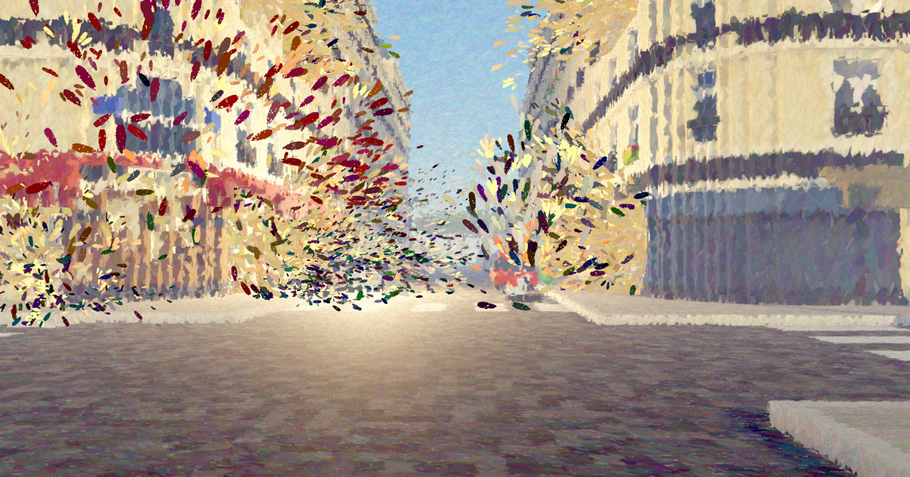
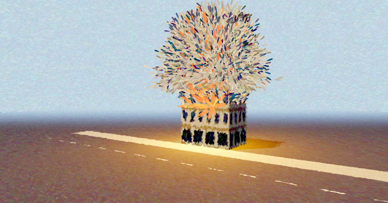
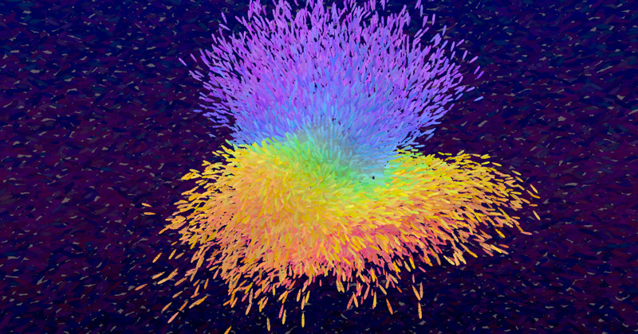

# three-painterly

[](https://www.npmjs.com/package/painterly-pass) [](https://www.npmjs.com/package/baked-debris) [](https://github.com/minchenlee/three-painterly/actions/workflows/test.yml) [](LICENSE)

Two small three.js modules, extracted from a voxel street-corner piece. Plain ES modules, no build step. Both need three.js r160 or later (WebGL 2).

```sh
npm i painterly-pass baked-debris three
```

**Live demos:** [Voxel Paris](https://mclee.dev/lab/voxel-paris/) · [Split Time](https://mclee.dev/lab/split-time/) · [Paint Pulse](https://mclee.dev/lab/paint-pulse/) (all at [mclee.dev/lab](https://mclee.dev/lab))

[](https://mclee.dev/lab/voxel-paris/)

| [Split Time](https://mclee.dev/lab/split-time/) | [Paint Pulse](https://mclee.dev/lab/paint-pulse/) |
|---|---|
| [](https://mclee.dev/lab/split-time/) | [](https://mclee.dev/lab/paint-pulse/) |

*Click an image to open the live demo. Source: [examples/voxel-paris](examples/voxel-paris/), [examples/split-time](examples/split-time/), [examples/paint-pulse](examples/paint-pulse/). All three use both modules.*

## PainterlyPass

A post-processing pass that repaints any three.js scene in brush strokes: impressionist oil by default, or pointillist dabs with `brush: pointillist()`. It replaces `RenderPass`: it renders the scene itself, rebuilds world positions from depth, and lays strokes on each surface's own plane, so strokes stay on the building, tree or ground when the camera moves. It does its own tone mapping and colour-space output, so do not add an `OutputPass` after it.

```js
composer.addPass(new PainterlyPass(scene, camera, { strokeSize: 7 }));
```

Prior art: Barbara Meier, *Painterly Rendering for Animation* (SIGGRAPH 1996), placed strokes on 3D surfaces; Sekuta82/oil-on-threejs-template does this per mesh in three.js. PainterlyPass does it as a post-process from the depth buffer, so it works on any scene without touching its meshes.

→ [packages/painterly-pass](packages/painterly-pass/README.md) · example: `packages/painterly-pass/examples/basic.html`

## BakedDebris

Explosion debris you can scrub and rewind. Collisions are baked once in the browser against your own `solid(x, y, z)` query and the ground; each piece's path is stored as a few ballistic segments in a float texture, and the GPU evaluates any moment directly. `setTime(t)` can jump anywhere, backwards included, and the result is always the same. Extras: bullet-time (`timeWarp`), secondary blasts, and `createStrokes({ painter })` to draw flying pieces as brush strokes on top of a PainterlyPass.

```js
const boom = new BakedDebris({ pieces, bursts, solid, ground: 0 });
scene.add(boom.mesh);
boom.setTime(seconds);
```

→ [packages/baked-debris](packages/baked-debris/README.md) · example: `packages/baked-debris/examples/explode.html`

## Run the examples

Serve the repository root over HTTP and open an example:

```sh
python3 -m http.server     # or: npx serve .
# http://localhost:8000/packages/painterly-pass/examples/basic.html
# http://localhost:8000/packages/baked-debris/examples/explode.html
# http://localhost:8000/examples/voxel-paris/
# http://localhost:8000/examples/split-time/
# http://localhost:8000/examples/paint-pulse/
# http://localhost:8000/examples/lightspeed-ram/
# http://localhost:8000/examples/balloon-house/
# http://localhost:8000/examples/grande-jatte/
```

`examples/voxel-paris` is a larger demo that uses both modules: a Paris street corner of about 5 million voxels, where 22 bursts along the street blow out the ground floor and chosen upper floors. Drag the time slider to scrub or rewind, change the time of day, and watch flying pieces turn into brush strokes. The Paint tab switches between oil strokes and pointillist dabs. It loads three.js from a CDN and builds the city in the browser (a few seconds on first load).

`examples/split-time` shows one building on two clocks: the lower floors fly back together from the rubble while the upper floors blow apart. It uses two BakedDebris bakes and plays one of them backwards.

`examples/paint-pulse` is a music visualizer. An oil-painted ball bursts into brush strokes on loud passages and beats, and pulls itself back together when the music goes quiet. It plays a built-in demo track, or you can open or drop your own audio file (BakedDebris + PainterlyPass + WebAudio).

`examples/lightspeed-ram`: a small cruiser jumps to lightspeed through a wide flagship. The cut wing breaks away, and the debris stream shreds the escorts behind it. There is no gravity: every piece gets its own launch time and velocity from where the ram passes it. A displace hook makes the two halves drift apart, and a material hook makes flying pieces glow white-hot and cool. Sliders set the paint stroke size, the debris stroke size, the debris amount (the cut is re-voxelized and re-baked) and a bloom glow. In painterly mode the stars are brush dabs over a faint painted nebula. The page remembers the last view and settings in the browser; Copy view copies them as text. The ships are original voxel shapes.

`examples/balloon-house`: thousands of balloons burst through the roof of a wooden house and carry it off over its street, painted with the pointillist brush. Every balloon is one dab of one pigment. The street is a voxel grid like Voxel Paris, meshed with baked ambient occlusion: six houses, gardens, fences, trees, parked cars. The middle of the roof blows off and its shingles tumble down the slopes and onto the porch; at lift-off the turf around the house breaks loose. Both collide with the voxels. The balloons are BakedDebris pieces too; bullet time gives the drag, and a displace hook draws each one to its place in the bunch and moves the bunch with the house. The house is a PainterlyPass anchor, so it carries its dabs as it flies. All the houses are original designs. Controls: four views, time of day, and a Look switch between dabs, oil strokes and plain cubes.

`examples/grande-jatte`: Georges Seurat's *A Sunday on La Grande Jatte* (1884–86, public domain) paints itself. Five sheets of dabs glide in from the left of a blank canvas, one after another: the ground (sky, river, lawn), then trees and boats, then some forty figures, back to front. A sheet in the air is the picture itself, stretched and rippling; it tightens as it lands. Every dab is a BakedDebris piece whose clock runs backwards, so the moment it "launches" is the moment it arrives and becomes part of the scene. A displace hook carries it there. Afterwards the camera leaves Seurat's viewpoint and the picture turns out to have depth. `minStrokeWorld` makes the dots grow when you move in close. The composition follows the painting; the voxel figures are this demo's own.

`examples/lib` holds what the voxel demos share. `voxels.js` has a palette, a dense grid, a mesher that bakes ambient occlusion and merges flat faces, and small sparse models that turn into BakedDebris pieces. `town.js` builds wooden houses, trees, fences, flower beds and cars from options. `people.js` builds figures, pets and boats of the 1880s. They are not part of either package.

## Use with your AI agent

[llms.txt](llms.txt) is a one-file summary of both APIs, options and pitfalls, written for coding agents. [AGENTS.md](AGENTS.md) is for agents that change this repository. Copy one of these prompts into your agent:

**Paint my scene**

```text
Read https://raw.githubusercontent.com/minchenlee/three-painterly/main/llms.txt.
Add PainterlyPass to my three.js scene so it looks like an impressionist oil painting.
Use it in place of my RenderPass, and remove any OutputPass after it.
Keep my camera, lights and controls. Add a key (P) that toggles the effect,
so I can compare. Start from the defaults; tell me which options you changed and why.
```

**Make something explode**

```text
Read https://raw.githubusercontent.com/minchenlee/three-painterly/main/llms.txt.
Use BakedDebris to blow apart <object> in my three.js scene.
Turn the object into cube pieces with meshToPieces, and put 1–3 bursts where it should break.
Give it a solid(x, y, z) collider for the walls and floor that the pieces should hit,
using a typed-array lookup. Add a time slider that scrubs forwards and backwards with setTime.
If the scene uses PainterlyPass, draw the flying pieces as brush strokes with createStrokes.
Do not move or scale boom.mesh; place the pieces and bursts in world space instead.
```

**Tune the look by description**

```text
Read https://raw.githubusercontent.com/minchenlee/three-painterly/main/llms.txt.
My scene uses PainterlyPass. Change its options so the painting looks <warmer / like dusk /
bolder strokes / softer and pastel / closer to the original>. Change only the PainterlyPass
options, show me the old and new values, and explain each change in one line.
```

PainterlyPass options change how the scene is painted (strokes, palette, contrast), not its light. An overall mood such as dusk needs the scene's lights and sky changed too: orange, low sun, a darker sky. For that, remove "Change only the PainterlyPass options" from the prompt.

## License

MIT. See [LICENSE](LICENSE).
